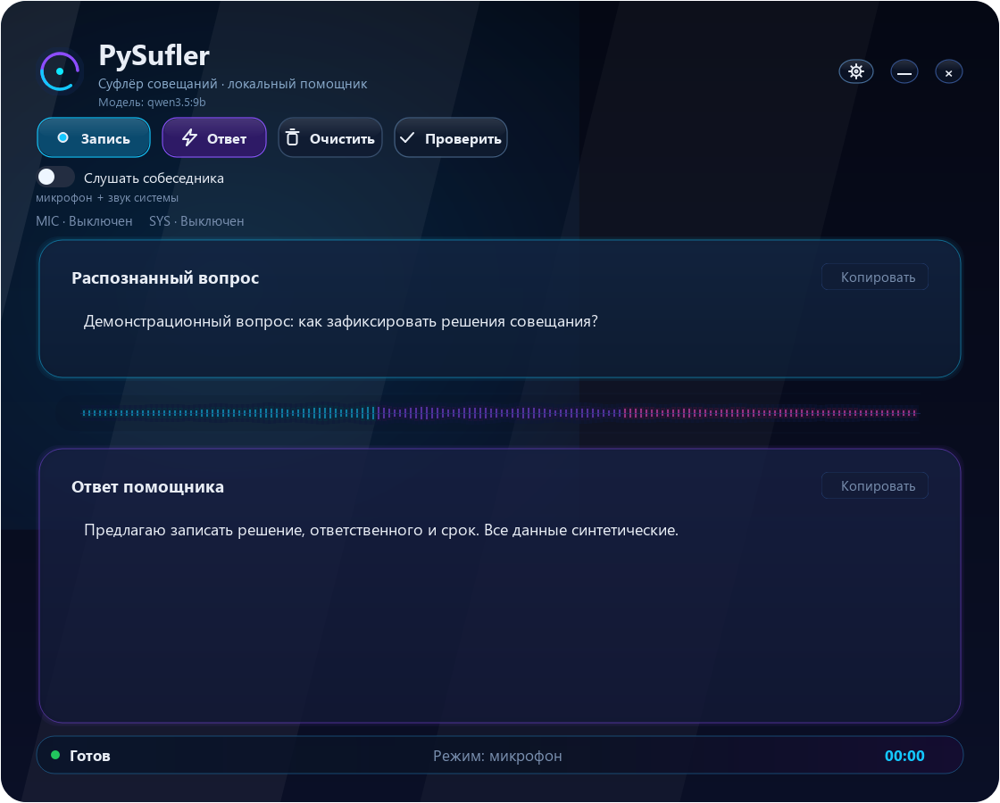
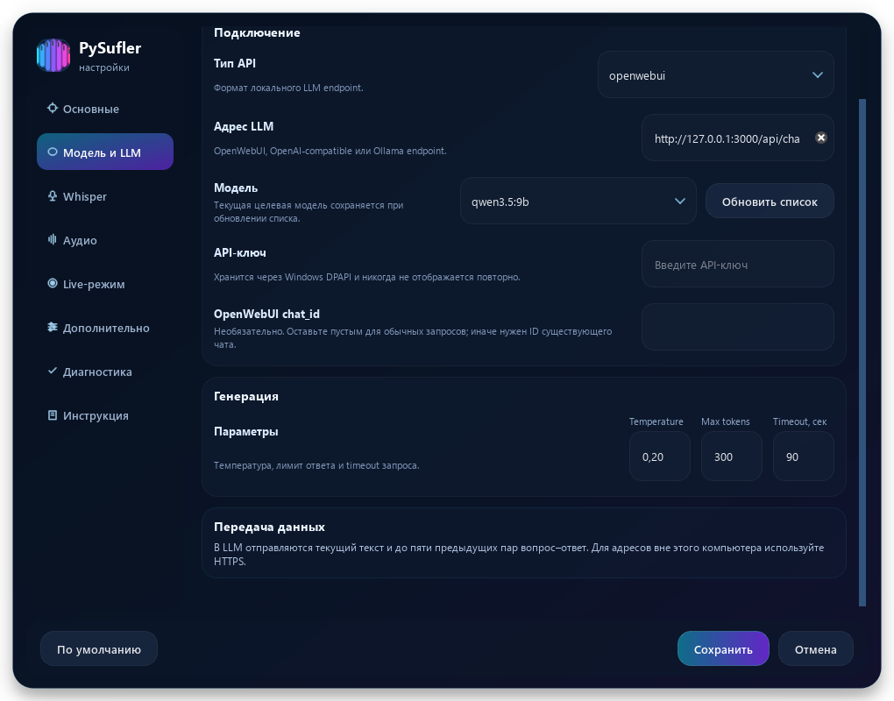
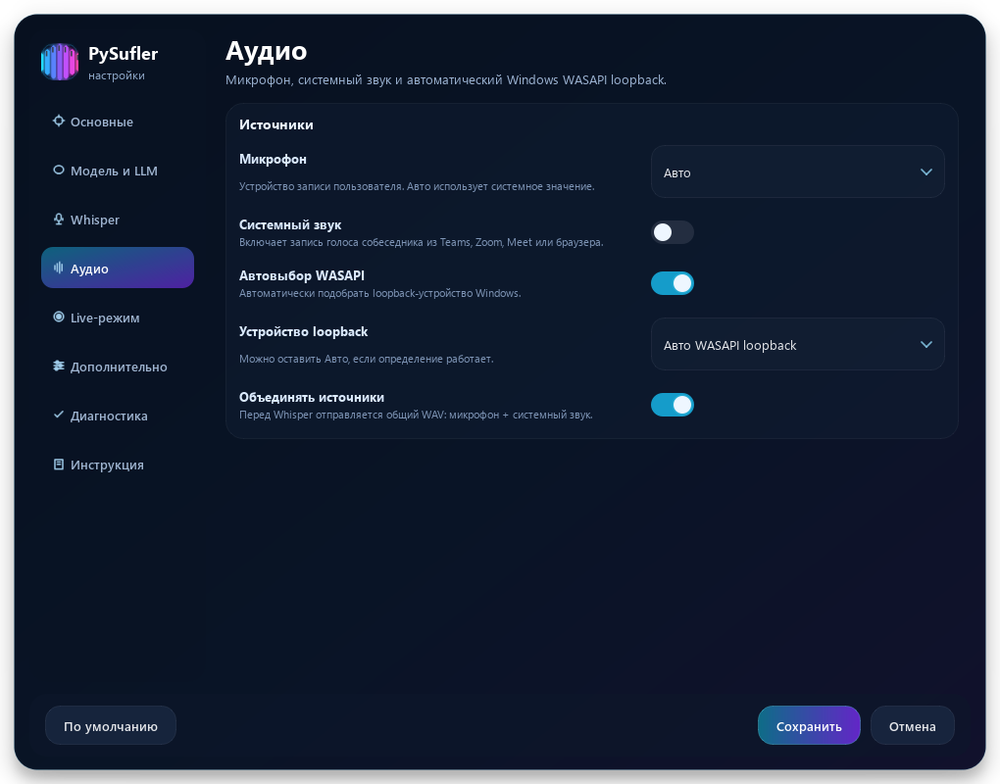
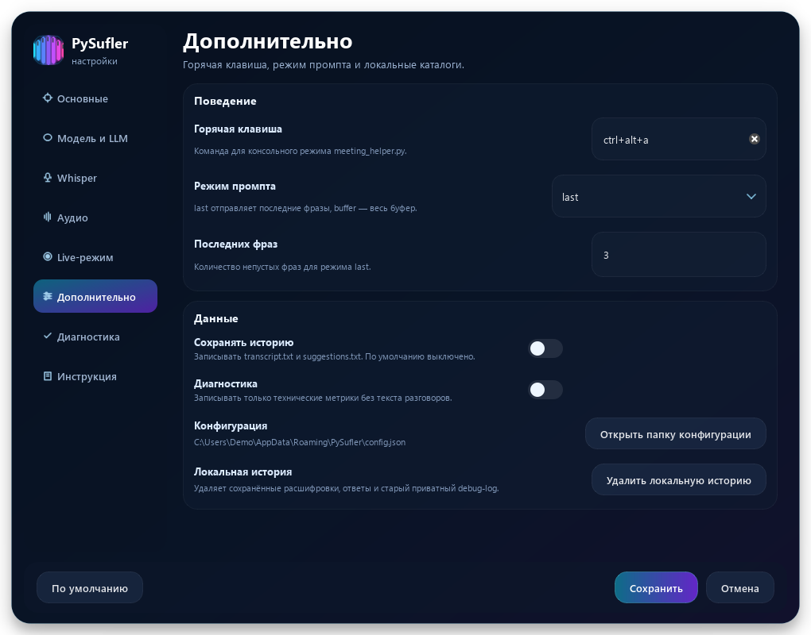

# PySufler — Суфлёр совещаний

PySufler — локальный desktop-помощник для совещаний. Он записывает микрофон и, при включённом режиме «Слушать собеседника», системный звук Windows через WASAPI loopback, расшифровывает речь через локальный faster-whisper OpenAI-compatible endpoint и отправляет текст в локальную LLM.

Текущая версия: **0.1.2**. Поддерживается Windows 10/11.

Whisper и LLM не входят в состав приложения. Для работы необходимо заранее запустить совместимый Whisper endpoint и OpenWebUI, Ollama или другой OpenAI-compatible LLM endpoint.

Основной запуск GUI: `meeting_helper_modern_gui.py`.

## Установка portable-версии

1. Скачайте ZIP-архив из Assets [релиза v0.1.2](https://github.com/s-rodger/PySufler/releases/tag/v0.1.2).
2. Распакуйте архив в отдельную папку с правом записи.
3. Запустите `PySufler.exe`.
4. Откройте настройки и укажите адреса Whisper и LLM, модель и при необходимости API-ключ.

Portable-сборка не включает Whisper, OpenWebUI или Ollama. Эти сервисы необходимо установить и запустить отдельно. Для удалённых адресов рекомендуется HTTPS.

Python для portable-версии устанавливать не требуется. Не запускайте EXE прямо внутри ZIP: распакуйте всю папку вместе с `_internal`.

Нажмите «Запись», произнесите вопрос и нажмите «Стоп». После распознавания нажмите «Ответ». Системный звук включается отдельно переключателем «Слушать собеседника».

## Возможности

- ручная запись вопроса;
- live-preview расшифровки во время записи;
- финальная расшифровка полного аудио после остановки;
- захват микрофона + системного звука;
- поддержка OpenWebUI/OpenAI-compatible, Ollama chat и Ollama generate;
- окно настроек без ручного редактирования `.env`;
- сохранение подсказок и расшифровок в `%APPDATA%\PySufler\data`;
- логи в `%APPDATA%\PySufler\logs`.

Сохранение расшифровок и ответов по умолчанию выключено и включается отдельно в настройках.

## Установка из исходников

```powershell
cd path\to\PySufler
python -m venv .venv
.\.venv\Scripts\activate
python -m pip install -r requirements.txt
```

Для первой настройки можно скопировать пример:

```powershell
copy .env.example .env
```

При первом запуске PySufler создаёт конфиг:

```text
%APPDATA%\PySufler\config.json
```

Если `config.json` ещё нет, но есть `.env`, настройки автоматически мигрируют из `.env` в JSON-конфиг. Файл `.env` не удаляется.

## Настройка

Откройте кнопку `⚙` в верхней панели приложения.

В настройках можно изменить:

- URL Whisper;
- тип LLM API: `openwebui`, `openai`, `ollama`, `ollama_generate`;
- URL LLM;
- модель, например `qwen3.5:9b`;
- `OPENAI_API_KEY` для OpenWebUI/OpenAI-compatible endpoint;
- необязательный `OPENWEBUI_CHAT_ID`;
- температуру, лимит токенов и timeout;
- микрофон;
- автоматический WASAPI loopback;
- live-распознавание.

Для OpenWebUI создайте API key в интерфейсе OpenWebUI: откройте профиль пользователя, раздел Settings/API Keys, создайте ключ и вставьте его в поле `OPENAI_API_KEY`.

В Windows ключ сохраняется отдельно от `config.json` и защищается DPAPI текущего пользователя. При первом запуске после обновления существующий ключ из `config.json` переносится автоматически. Исходный `.env` не изменяется и может продолжать содержать ключ открытым текстом, поэтому храните его только локально.

Безопасные публичные значения по умолчанию находятся в `.env.example` и используют `127.0.0.1`.

Примеры для сервисов на этом же компьютере:

| Сервис | Тип API | Адрес в настройках |
| --- | --- | --- |
| Open WebUI | `openwebui` | `http://127.0.0.1:3000/api/chat/completions` |
| Ollama | `ollama` | `http://127.0.0.1:11434/api/chat` |
| Совместимый Whisper | поле «Адрес Whisper» | `http://127.0.0.1:8001/v1/audio/transcriptions` |

В LLM-сервисе должна быть установлена и доступна выбранная модель, например `qwen3.5:9b`. Для Ollama её можно загрузить командой `ollama pull qwen3.5:9b`. Для Open WebUI выберите точный ID из списка доступных моделей и при необходимости задайте API-ключ.

Для обычных запросов Open WebUI оставьте `OPENWEBUI_CHAT_ID` пустым: фиктивный ID приводит к HTTP 404. Это поле нужно только для ID существующего доступного чата. «Проверить подключение» проверяет не только список моделей, но и тестовый запрос.

Whisper должен принимать WAV через `POST /v1/audio/transcriptions` и возвращать JSON с полем `text`. Укажите фактический адрес уже запущенного совместимого сервиса: приложение не устанавливает его автоматически.

## Запуск

Через bat-файл:

```powershell
.\Start Meeting Helper.bat
```

Напрямую:

```powershell
.\.venv\Scripts\pythonw.exe meeting_helper_modern_gui.py
```

Перезапуск:

```powershell
.\Restart Meeting Helper.bat
```

Проверка:

```powershell
.\Check Meeting Helper.bat
```

## Системный звук

Захват системного звука работает на Windows через WASAPI loopback. Включите переключатель `Слушать собеседника`, чтобы записывать микрофон и звук из Teams/Zoom/Meet/браузера.

По умолчанию:

```text
SYSTEM_AUDIO_ENABLED=false
AUTO_SYSTEM_LOOPBACK=true
MIX_MIC_AND_SYSTEM_AUDIO=true
```

Системный звук для новой установки выключен до явного включения переключателя `Слушать собеседника`.

Если автоматический loopback недоступен, приложение не падает и продолжает слушать микрофон. Как fallback можно использовать VB-CABLE или похожий virtual audio cable.

Сохранённое состояние переключателя имеет приоритет: если системный звук выключен, после перезапуска он не включается автоматически.

Индикаторы MIC и SYS показывают фактический захват: «Выключен» — поток не активен,
«Поток открыт» — поток активен без недавнего сигнала, «Есть сигнал» — за последнюю
секунду поступали ненулевые аудиоданные. Сигнал не обязательно является речью.

## Передача и хранение данных

- Whisper получает WAV с микрофона и, если включено, системного звука. Аудио формируется в памяти и не сохраняется как WAV на диск.
- LLM получает системную инструкцию, текущую расшифровку и до пяти предыдущих пар вопрос–ответ из текущего сеанса. Аудио в LLM не отправляется.
- При включённой локальной истории расшифровки сохраняются в `transcript.txt`, ответы — в `suggestions.txt` внутри `%APPDATA%\PySufler\data`.
- Диагностический режим по умолчанию выключен. При включении он записывает только технические метрики и типы ошибок без текста разговоров и API-ключей.
- Действие `Удалить локальную историю` в настройках удаляет transcript, suggestions и старый приватный Whisper debug-log только после подтверждения.

Перед записью совещания убедитесь, что участники уведомлены и локальные правила разрешают запись. Системный звук может содержать уведомления и звук других приложений.

Значения по умолчанию используют `127.0.0.1`. Если Whisper или LLM находятся на другом компьютере, используйте HTTPS: при обычном HTTP аудио, расшифровки и API-ключ передаются без шифрования транспорта.

## Консольный режим

Список устройств:

```powershell
python meeting_helper.py --list-devices
```

Проверка LLM без микрофона:

```powershell
python meeting_helper.py --test-llm "Ответь кратко: что такое Солнце?"
```

## Ограничения

- захват системного звука поддерживается только в Windows через WASAPI loopback;
- live-текст формируется отдельными фрагментами и может быть менее точным, чем финальное распознавание после остановки;
- приложение не разделяет участников по голосам;
- качество и скорость зависят от внешних Whisper/LLM endpoint и выбранной модели;
- при недоступности сервисов приложение показывает ошибку, но не запускает и не настраивает их автоматически.

Версия 0.1.2 прошла ручную приёмку пользователя, включая остановку записи. Отдельная проверка portable на чистой Windows VM без Python и Qt не проводилась.

## Скриншоты

Все примеры синтетические: это не записи пользовательских совещаний. Путь профиля `Demo` и адреса loopback приведены для демонстрации.



<details>
<summary>Настройки модели и передача данных</summary>



</details>

<details>
<summary>Микрофон и системный звук</summary>



</details>

<details>
<summary>История и диагностика</summary>



</details>

## Сборка portable exe

```powershell
.\build_windows.bat
```

Результат:

```text
dist\PySufler\PySufler.exe
```

Сборка использует PyInstaller onedir, без консоли, с иконкой `meeting_helper.ico`.

## Конфигурация и данные

Конфигурация приложения и API-ключи хранятся локально и не входят в состав репозитория. В Windows API-ключ защищён DPAPI и доступен только в контексте текущего пользователя. При публикации собственных изменений не добавляйте в Git файл `.env`, пользовательские `config.json` и `secrets.json`, логи, записи совещаний и другие персональные данные.

## Лицензия

[MIT](LICENSE), Copyright (c) 2026 s-rodger.
